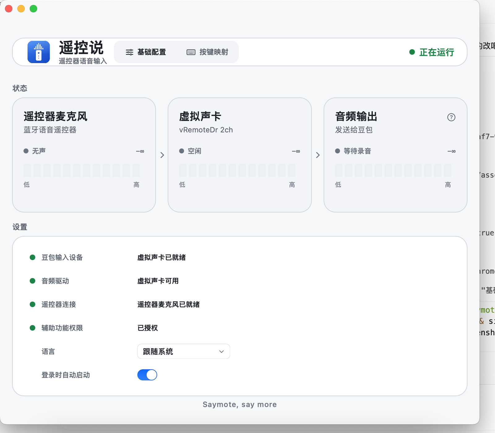
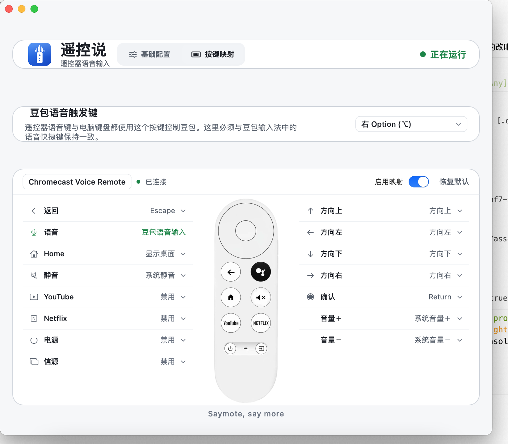

# 遥控说 (Saymote)

> 把蓝牙语音遥控器变成 macOS 上的语音输入利器（无缝联动豆包输入法等）。

[](https://github.com/harrylong321-netizen/saymote)
[](#开源协议)
[](https://github.com/harrylong321-netizen/saymote/releases/tag/v1.0.0)

---

## 🌟 核心特性与亮点

- ⚡ **超强低版本兼容（macOS 12+）**  
  市面上同类软件普遍强制要求 macOS 13 (Ventura) 甚至 macOS 14 (Sonoma) 以上。**「遥控说」专门针对低版本 CoreAudio 进行了向下兼容适配，完整支持 macOS 12 (Monterey) 及更高版本**，老款 Intel Mac 或未升级系统的 Mac 设备均可流畅运行。
- 🎙️ **遥控器语音双模式**  
  完美支持遥控器语音键：
  - **短按模式**：单击开始录音，再按一次停止录音并自动输入文字；
  - **长按模式**：按住语音键说话，松手立即停止录音。
- 🎛️ **全键位自由映射**  
  支持将遥控器的方向键（上/下/左/右）、确认键、返回键、Home 键、音量键等自由映射为任意 macOS 快捷键（如 Esc、回车、切换标签、系统静音等），化身工作与代码演示神器。
- 🎚️ **虚拟声卡独立音频路由**  
  内置轻量虚拟音频驱动 `vRemoteDr 2ch`，实时将遥控器蓝牙语音流解码并路由为独立的 macOS 音频输入设备，不占用、不干扰电脑本机麦克风。

---

## 📸 界面预览

| 基础配置与音频流水线 | 遥控器全键位按键映射 |
| :---: | :---: |
|  |  |

---

## 🕹️ 支持硬件与蓝牙配对指南

当前正式支持 **Google Chromecast Voice Remote**（即 Google TV 蓝牙语音遥控器，VID `0x18D1` / PID `0x9450`）。

### 遥控器蓝牙配对步骤：
1. 同时长按遥控器上的 **【返回键 ⬅】 + 【主页键 🏠】 约 3~5 秒**；
2. 遥控器底部的 LED 指示灯开始呼吸/闪烁（进入可发现配对状态）；
3. 打开 Mac 的 **「系统设置」->「蓝牙」**，在设备列表中找到 **`Chromecast Remote`**，点击连接即可。

---

## 📥 下载与安装必读（未签名放行）

前往 [Releases 页面](https://github.com/harrylong321-netizen/saymote/releases) 下载最新的 `Saymote-1.0.0-xxxxxxxx.zip`（内含 `.pkg` 安装包及 `安装必读（打不开看这里）.txt`）。

由于本软件由个人开源免费提供，尚未向苹果官方购买每年 99 美元的商业开发者年费证书，macOS 系统（Gatekeeper）在首次打开安装包时可能会弹出安全拦截提示：
> **“无法打开，因为无法验证开发者”** 或 **“macOS 无法验证此 App 不包含恶意软件”**

**本软件代码完全开源透明无害，请任选以下一种方法放行安装（只需操作一次）：**

- **方法 1（最简单，推荐）：右键打开**  
  **不要直接双击**安装包！请**右键点击**（或触控板**双指轻按**）安装包 `Saymote-xxx.pkg` -> 选择 **「打开」** -> 在弹出的系统提示框中点击 **「仍要打开」** 即可。
- **方法 2：系统设置放行**  
  若双击被拦截，打开 Mac 的 **「系统设置」->「隐私与安全性」**，滑到最底部，点击“已阻止使用 Saymote...”旁的 **「仍要打开」** 并输入电脑密码即可。
- **方法 3：终端解除隔离**  
  打开“终端”执行：`xattr -cr ~/Downloads/Saymote*.pkg` 移除隔离属性后直接双击安装。

---

## ⚙️ 首次配置说明

安装完成后应用会自动启动，并打开控制台：
1. **蓝牙权限**：根据系统提示允许，用于接收遥控器音频；
2. **辅助功能权限**：点击面板上的红色 **「设置」** 按钮前往系统授权，用于拦截并映射按键；
3. **豆包输入法设置**：点击面板上豆包输入设备的红色 **「设置」** 按钮，将引导您打开豆包设置，把麦克风选为 **`vRemoteDr 2ch`**；
4. 配置完成后，按一下遥控器麦克风键测试，控制台所有状态变绿即表示就绪！

---

## 🗑️ 如何彻底卸载

如果您不再需要使用本软件，可在 Mac 终端中运行以下一行命令彻底删除应用及系统级虚拟声卡驱动：

```bash
sudo rm -rf /Applications/遥控说.app /Library/Audio/Plug-Ins/HAL/vRemoteDriver.driver && sudo killall coreaudiod
```

---

## 🙏 致谢与开源溯源

本项目最初基于并借鉴了以下优秀开源项目（详情见 [`THIRD_PARTY_NOTICES.md`](THIRD_PARTY_NOTICES.md)）：

- **[VincentKingHsu/vRemoter](https://github.com/VincentKingHsu/vRemoter)**（MIT License）：提供了初始 macOS 应用架构、音频管道、按键映射与驱动构建思路，在此对原作者的技术探索与硬件逆向实践致以诚挚的敬意与感谢！
- **[fanxeon/mi-ao](https://github.com/fanxeon/mi-ao)**（MIT License，Copyright (c) 2026 FanXeon@Poemcoder with Codex）：仓库内 `Sources/Saymote/ATVV/` 下的 ATVV 协议解析与 IMA/DVI ADPCM 解码实现沿用自该项目模块。
- **[b0o/ATVVoice](https://github.com/b0o/ATVVoice)**（MIT License）与 Google Voice over BLE 规范：蓝牙语音协议参考。
- **[ExistentialAudio/BlackHole](https://github.com/ExistentialAudio/BlackHole)**（GNU GPL v3）：提供虚拟音频驱动底层基础。

由于我们在后续开发中，在交互理念、配置引导（如极简单步流程与智能状态感知）、系统兼容性（深度向下兼容 macOS 12+）以及整体产品体验上进行了大幅度的重构与调整，为了更清晰地规划独立的功能演进，故以全新的 **「遥控说 (Saymote)」** 品牌独立发布与维护。

---

<a id="开源协议"></a>
## 📄 开源协议

- **App 本体源码**（`Sources/`、`Packaging/` 等）：采用 [**MIT License**](LICENSE) 授权开源；
- **内置虚拟声卡驱动**（`vRemoteDriver.driver`）：基于 [**ExistentialAudio/BlackHole v0.4.1**](https://github.com/ExistentialAudio/BlackHole/tree/v0.4.1) 二次修改构建，遵循 **GNU GPL v3** 协议；本仓库已完整提供可复现的修改与构建脚本 [`Driver/build-driver.sh`](Driver/build-driver.sh)，驱动包内部亦保留原始 GPL v3 协议副本。

详见 [`LICENSE`](LICENSE) 与 [`THIRD_PARTY_NOTICES.md`](THIRD_PARTY_NOTICES.md)。
